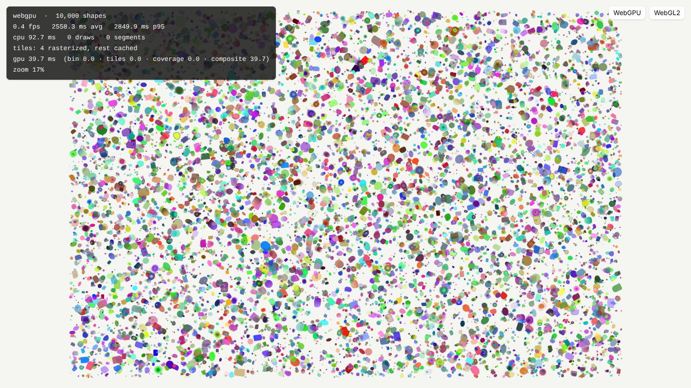

# Fig Tree

Fig Tree is an open-source, collaborative interface design tool. It pairs the vector precision designers expect (pen tool, vector networks, booleans, components and variables) with a canvas that speaks code natively: frames lay out with real CSS flexbox and grid, text shapes like the browser shapes it, and every design can be read, diffed and exported as working code. Teams and AI agents work on the same document side by side. Our agentic cursor, Sprout, edits the canvas next to you through the same operations you use. The whole stack is ours and open: a GPU renderer written for this job, a CRDT document model, and our own layout and text engines. Fig Tree is licensed under the AGPL-3.0.

> Status: **Module 2**. Modules 1 and 2 built the monorepo, geometry, the GPU renderer and its benchmark, and the CRDT document model with its command API, per-user undo, reviewable proposals, the `.figtree` format and the renderer bridge. The editor at `/` renders a sample document with a layer tree; editing tools, layout and text are next. See [`docs/parity.md`](docs/parity.md) for what works today.



## What is here

| Package | What it is |
|---|---|
| [`packages/geometry`](packages/geometry) | Affine matrices, paths, tight bounds, adaptive flattening (screen-space tolerance), stroking (miter/round/bevel joins, butt/round/square caps, dashes), rounded rects with per-corner radii and G2 corner smoothing, ellipses. |
| [`packages/renderer`](packages/renderer) | Retained-mode scene renderer. **WebGPU:** compute-shader tile binning and exact analytic coverage (nonzero and even-odd), plus a compositing pass. **WebGL2 fallback:** stencil-then-cover with 4x MSAA. Both share an rbush spatial index, per-node GPU buffer caching and a screen-tile cache for panning. |
| [`packages/document`](packages/document) | The document: a Yjs CRDT of nodes with CSS-semantic properties validated by zod schemas (box model, sizing, positioning, flex and grid, paint stacks, strokes, effects, typography, vector networks, text runs). Also: a command API with atomic batches (the single mutation path for the UI, agents and the MCP server), per-user undo, fork-and-diff proposals, the `.figtree` file format with a published JSON Schema, and the incremental bridge to the renderer. |
| [`apps/editor`](apps/editor) | Next.js app: the editor (`/`: a sample document, layer tree and CSS inspector; `/?doc=grid10k` opens a 10,000-node document), the 10k-shape renderer benchmark (`/bench`) and a render-test harness (`/render-test`). |

Read [`docs/architecture.md`](docs/architecture.md) for how the renderer and the document model work and how layout and text plug in. The file format is described there and in [`docs/format/figtree.schema.json`](docs/format/figtree.schema.json). Benchmark numbers are in [`docs/benchmarks.md`](docs/benchmarks.md).

## Getting started

Requires Node.js 20.9+ (CI uses 22).

```bash
npm install
npm run dev -w @fig-tree/editor     # http://localhost:3000, benchmark at /bench
```

`/bench?renderer=webgl2` forces the WebGL2 fallback, and `/bench?renderer=webgpu` requires WebGPU. Without a parameter, the renderer uses WebGPU when the browser supports it.

## Scripts

| Command | What it does |
|---|---|
| `npm run typecheck` | Strict TypeScript across packages, e2e tests and the app. Run it with `NODE_OPTIONS=--max-old-space-size=8192`. |
| `npm test` | Vitest unit and property tests: geometry, tiling math, scene and draw list, tile cache, and the document model. Document tests cover schemas, commands, 50-seed CRDT convergence, undo, proposals, the file format and the bridge. |
| `npm run build` | Production build of the editor. |
| `npm run test:render` | Playwright pixel-quality suite on both backends, plus the editor tests. Run `npm run build` first. |
| `npm run bench` | Playwright benchmarks on both backends: pan and zoom over 10k shapes, and single-property updates on a 10k-node document. Writes `test-results/bench.json` and `test-results/document-bench.json`. |

Playwright launches Chromium with `--enable-unsafe-webgpu` and SwiftShader flags (see `playwright.config.ts`), so the GPU tests run on machines without a GPU. Useful environment variables:
- `UPDATE_GOLDENS=1` rewrites `e2e/goldens/`.
- `UPDATE_SCHEMA=1 npm test` regenerates `docs/format/figtree.schema.json` after a schema change (a test fails while it is stale).
- `UPDATE_DOCS=1` refreshes the screenshots in `docs/img/`.
- `E2E_PORT` points the tests at an already running server.

## License

Fig Tree is licensed under the [GNU Affero General Public License v3.0](LICENSE). A few files are ported from other open-source projects and keep their original license. They are listed in [`THIRD_PARTY_NOTICES.md`](THIRD_PARTY_NOTICES.md).

Fig Tree is an independent project. It is not affiliated with Figma or Paper.
